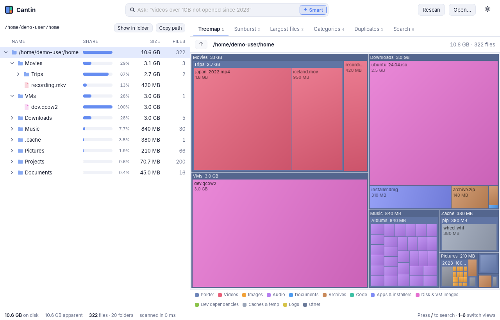

# Cantin

**See what's using your disk.** Cantin is a fast, open-source storage analyzer for **macOS, Windows and Linux**.



- **Fast parallel scanner.** It scans a 4.7 GB tree with about 80k files in about 0.5 s on SSD, and finds hard links, sparse files and symlink loops correctly.
- **Size tree.** A sortable folder tree with size bars, file counts and keyboard navigation.
- **Treemap and sunburst.** Canvas-rendered views that zoom when you click into a folder.
- **Largest files.** Across the whole scan or just the current folder.
- **Categories.** Space grouped by type: videos, images, archives, disk images, `node_modules` and build folders, caches and more.
- **Duplicate finder.** It compares sizes, then a quick 128 KB fingerprint, then a full BLAKE3 hash, and shows how much space you could free.
- **Smart search.** Ask in plain English, for example *"videos over 1GB I haven't touched since 2023"*. Your request becomes filters you can see and edit. It runs entirely on your computer, using built-in rules or a local open-source model through **Ollama** or **llama.cpp**.
- **Read-only by design.** Cantin never deletes anything. Use *Show in folder* or *Copy path* to act on what you find.

## Download

Get installers for your OS (`.dmg`, `.msi`/`.exe`, `.AppImage`, `.deb`) from the [Releases](../../releases) page.

> macOS: to scan everything, grant Cantin **Full Disk Access** in System Settings → Privacy & Security.
> Builds are not code-signed yet, so the first launch needs right-click → Open on macOS, or "More info → Run anyway" on Windows.

## Smart search with a local AI model (optional)

The model only turns your sentence into a small JSON filter, which Cantin runs against the scan in memory. File names and contents never leave your machine, and the model never sees them.

| Engine | Setup |
| --- | --- |
| Built-in rules (default) | Nothing to install. Understands types, sizes, dates and common folders. |
| Ollama | Install [Ollama](https://ollama.com), run `ollama pull qwen2.5:3b`, then pick *Ollama* in Settings. |
| llama.cpp / LM Studio | Run `llama-server -hf Qwen/Qwen2.5-3B-Instruct-GGUF --port 8080`, then pick *llama.cpp* in Settings. |

Output is constrained with a JSON schema, so it always parses into a filter. If the model server can't be reached, Cantin falls back to the built-in rules and tells you.

## Command line

The same engine ships as a CLI, which is handy for scripts and servers:

```bash
cargo run --release -p cantin-cli -- scan ~/            # largest folders, files, categories
cargo run --release -p cantin-cli -- scan / --json      # machine-readable
cargo run --release -p cantin-cli -- dupes ~/Pictures --min-size 1MB
cargo run --release -p cantin-cli -- ask ~/ "pdfs in Downloads older than 2022"
cargo run --release -p cantin-cli -- ask ~/ "big videos" --ollama qwen2.5:3b
```

## Development

Prerequisites: Rust (stable), Node 20+, and on Linux the
[Tauri system packages](https://v2.tauri.app/start/prerequisites/)
(`libwebkit2gtk-4.1-dev libgtk-3-dev librsvg2-dev libayatana-appindicator3-dev libxdo-dev`).

```bash
npm install
npm run tauri dev                 # run the app with hot reload
npm run tauri dev -- -- ~/Downloads   # …and scan a folder on launch (or CANTIN_SCAN=path)
npm run tauri build               # installers in target/release/bundle
cargo test -p cantin-core         # engine tests
```

### Layout

```
crates/cantin-core   scanning, tree, categories, duplicates, query engine, AI translation (no GUI deps)
crates/cantin-cli    `cantin` command-line tool
src-tauri            desktop app: Tauri commands wrapping cantin-core
src                  React + TypeScript UI (Zustand, d3-hierarchy, canvas rendering)
```

The scan result stays in Rust. The UI asks for small views of it (one folder's children, a pruned treemap layout, the top N files), so scans with millions of files don't overload the web view.

### Accuracy notes

- Sizes are **allocated bytes on disk**, like `du`; the apparent size is also shown. Hard links are counted once.
- Symlinks and Windows junctions are never followed. By default the scan stays on one filesystem and skips `/proc`, `/sys` and `/dev`.
- On macOS, scanning `/` includes the Data volume once (through firmlinks) and skips `/System/Volumes` to avoid double counting.
- Windows currently rounds sizes up to 4 KB clusters and does not deduplicate hard links yet. Both are on the roadmap.

## Roadmap

- [ ] Embedded llama.cpp with a one-click model download (no separate Ollama install)
- [ ] Exact allocated sizes and hard-link IDs on Windows (`GetCompressedFileSizeW`, file IDs)
- [ ] Optional *Move to Trash* with safety guards
- [ ] Fast NTFS scanning via the MFT (admin)
- [ ] Code signing and notarization, auto-update
- [ ] Semantic search of file contents with local embeddings

## License

MIT
