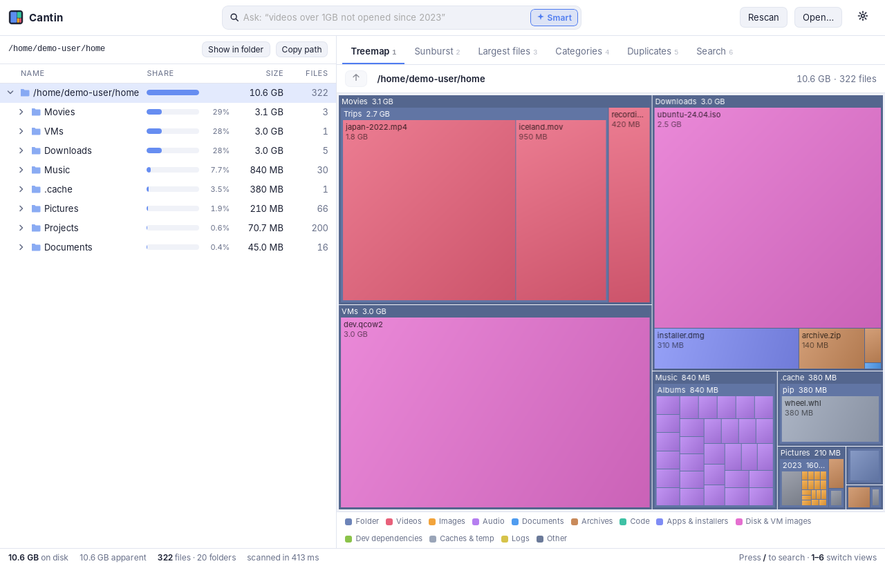
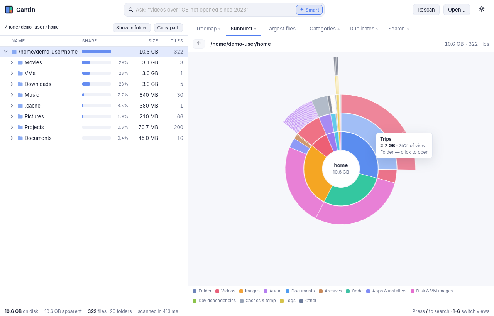
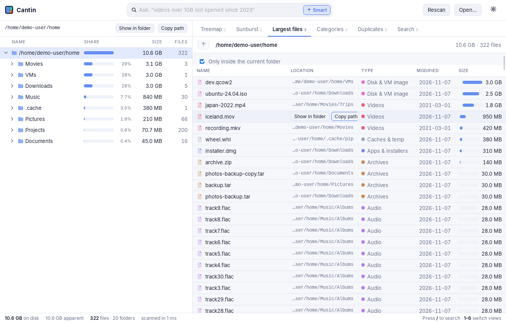
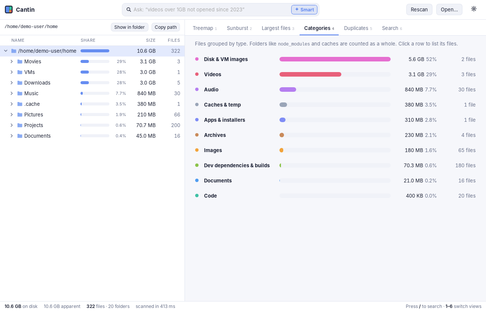
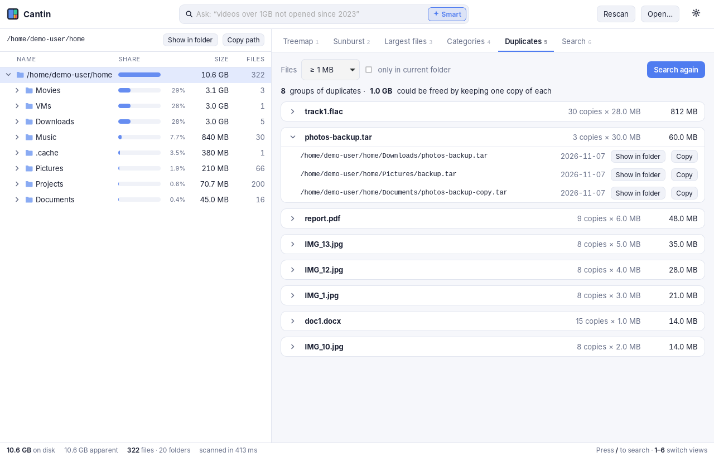
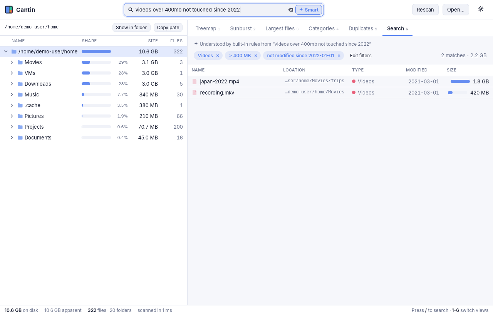
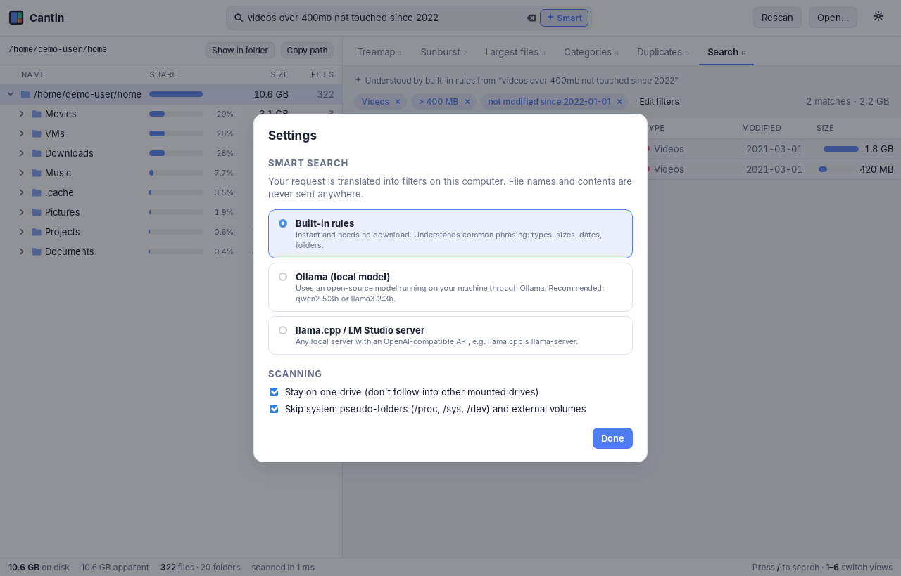

<div align="center">


# Cantin

**See what's using your disk.**<br/>
A fast, free and open-source storage analyzer for **macOS**, **Windows** and **Linux**.

[](https://github.com/Darshan-Subramanya/cantin/actions/workflows/ci.yml)
[](https://github.com/Darshan-Subramanya/cantin/releases)
[](LICENSE)

[**Download**](https://github.com/Darshan-Subramanya/cantin/releases/latest) · [Install](#install) · [Screenshots](#screenshots) · [Build from source](#build-from-source)



</div>

## Features

- **Fast parallel scan.** It reads tens of thousands of files per second and stays accurate: sizes match `du`, hard links are counted once, and symlinks are never followed.
- **Size tree.** A sortable folder tree with size bars and file counts. Use the arrow keys to move through it.
- **Treemap and sunburst.** Click into any folder to zoom in.
- **Largest files.** Across the whole drive or just the current folder.
- **Categories.** Space grouped by videos, images, archives, disk images, `node_modules` and build folders, caches and more.
- **Duplicate finder.** Finds files with identical content and shows how much space you could get back.
- **Smart search.** Ask in plain English, for example *"videos over 1GB I haven't touched since 2023"*. It runs entirely on your computer.
- **Safe.** Cantin never deletes anything. Use *Show in folder* or *Copy path* to act on what you find.

## Install

Download the installer for your system from the
[**latest release**](https://github.com/Darshan-Subramanya/cantin/releases/latest).

| System | File to download |
| --- | --- |
| macOS, Apple Silicon (M1–M4) | `Cantin_<version>_aarch64.dmg` |
| macOS, Intel | `Cantin_<version>_x64.dmg` |
| Windows 10/11 | `Cantin_<version>_x64-setup.exe` or `Cantin_<version>_x64_en-US.msi` |
| Linux, any distro | `cantin_<version>_amd64.AppImage` |
| Debian, Ubuntu, Mint | `cantin_<version>_amd64.deb` |
| Fedora, RHEL, openSUSE | `cantin-<version>-1.x86_64.rpm` |

> Cantin is not code-signed yet, so your OS will warn you the first time you open it. Each section below shows how to get past the warning.

### macOS

1. Open the `.dmg` and drag **Cantin** into **Applications**.
2. The first time, **right-click Cantin → Open**, then confirm. If macOS says the app is damaged, run this in Terminal once:
   ```bash
   xattr -dr com.apple.quarantine /Applications/Cantin.app
   ```
3. To scan your whole disk, open **System Settings → Privacy & Security → Full Disk Access**, turn on **Cantin**, and reopen the app.

### Windows

1. Run the `-setup.exe` (or the `.msi`).
2. If SmartScreen says *"Windows protected your PC"*, click **More info → Run anyway**.
3. Cantin then appears in the Start menu. To include protected system folders in a scan, right-click → **Run as administrator**.

Cantin uses the Microsoft Edge WebView2 runtime. It's built into Windows 11, and the installer adds it on Windows 10 if it's missing.

### Linux

**AppImage (any distro):**
```bash
chmod +x cantin_*_amd64.AppImage
./cantin_*_amd64.AppImage
```

**Debian / Ubuntu:**
```bash
sudo apt install ./cantin_*_amd64.deb
```

**Fedora / RHEL:**
```bash
sudo dnf install ./cantin-*.x86_64.rpm
```

Your home folder needs no special permissions. To scan system folders such as `/var` or `/`, start Cantin with `sudo`, or accept that unreadable folders are marked 🔒 and skipped.

## Screenshots

| | |
| :---: | :---: |
|  **Sunburst:** nested folders as rings |  **Largest files:** across the drive or one folder |
|  **Categories:** space by file type |  **Duplicates:** identical files and space to reclaim |
|  **Smart search:** plain English becomes editable filters |  **Settings:** choose the local AI engine |

## Smart search and local AI (optional)

Type a request in the search box with **✦ Smart** turned on. Cantin turns it into filters you can see and edit as chips. File names and contents never leave your computer.

| Engine | Setup |
| --- | --- |
| **Built-in rules** (default) | Nothing to install. Understands file types, sizes, dates and common folders. |
| **Ollama** | Install [Ollama](https://ollama.com), run `ollama pull qwen2.5:3b`, then choose *Ollama* in ⚙ Settings. |
| **llama.cpp / LM Studio** | Start a local server, e.g. `llama-server -hf Qwen/Qwen2.5-3B-Instruct-GGUF --port 8080`, then choose it in ⚙ Settings. |

If the model can't be reached, Cantin uses the built-in rules and tells you.

## Build from source

**1. Install the prerequisites:**

| OS | What to install |
| --- | --- |
| All | [Rust](https://rustup.rs) (stable) and [Node.js](https://nodejs.org) 20+ |
| macOS | Xcode Command Line Tools: `xcode-select --install` |
| Windows | [Visual Studio Build Tools](https://visualstudio.microsoft.com/visual-cpp-build-tools/) with "Desktop development with C++" (WebView2 is built into Windows 11) |
| Linux (Debian/Ubuntu) | `sudo apt install libwebkit2gtk-4.1-dev libgtk-3-dev librsvg2-dev libayatana-appindicator3-dev libxdo-dev` |

For other Linux distros, see the [Tauri prerequisites](https://v2.tauri.app/start/prerequisites/).

**2. Run the app:**

```bash
git clone https://github.com/Darshan-Subramanya/cantin.git
cd cantin
npm install
npm run tauri dev       # run with hot reload
```

**3. Build installers.** They are written to `target/release/bundle/`:

```bash
npm run tauri build
```

**4. Run the engine tests:**

```bash
cargo test -p cantin-core
```

### Command-line tool

The same engine is also available as a CLI:

```bash
cargo run --release -p cantin-cli -- scan ~               # largest folders, files, categories
cargo run --release -p cantin-cli -- dupes ~/Pictures --min-size 1MB
cargo run --release -p cantin-cli -- ask ~ "pdfs in Downloads older than 2022"
```

### Project layout

```
crates/cantin-core   scanner, tree, categories, duplicates, search, AI translation
crates/cantin-cli    `cantin` command-line tool
src-tauri            desktop app (Tauri 2) wrapping cantin-core
src                  UI (React + TypeScript, canvas treemap/sunburst)
```

## Roadmap

- [ ] Built-in local model with one-click download, so Ollama isn't needed
- [ ] Exact on-disk sizes and hard-link detection on Windows
- [ ] Optional *Move to Trash* with safety checks
- [ ] Code signing and notarization, and auto-update
- [ ] Very fast NTFS scanning through the MFT

## License

[MIT](LICENSE) © Darshan M Subramanya and contributors
